# CENTRIA — Sovereign Data Model & Entity Relationship Catalog

## 1. Entity Relationship Diagram (Mermaid)

```mermaid
erDiagram
    COMPANY ||--o{ MEMBERSHIP : has
    COMPANY ||--o{ TASK : scopes
    COMPANY ||--o{ APPROVAL_REQUEST : ratifies
    COMPANY ||--o{ BANK_BALANCE : holds
    COMPANY ||--o{ EXPENSE_CARD : issues
    COMPANY ||--o{ STATUTORY_OBLIGATION : tracks
    COMPANY ||--o{ INTEGRATION_CONNECTOR : connects
    COMPANY ||--o{ AUDIT_EVENT : records

    COMPANY {
        uuid id PK
        string name
        string cin UK "U72900KA2024PTC189201"
        string gstin "29AABCC1234F1Z5"
        string pan "AABCC1234F"
        string tan "BLRC12345D"
        string roc_jurisdiction "ROC Bangalore"
        string registered_office
        boolean is_active
        datetime created_at
    }

    MEMBERSHIP {
        uuid id PK
        uuid company_id FK
        uuid user_id FK
        string role "DIRECTOR, CFO, CS, AUDITOR"
        string din_number "DIN #09124819"
        boolean is_active
    }

    TASK {
        uuid id PK
        uuid company_id FK
        string task_code "TSK-IN-101"
        string title
        string subtitle
        string priority "CRITICAL, HIGH, MEDIUM, LOW"
        string status "TODO, IN_PROGRESS, PENDING_REVIEW, COMPLETED"
        string assignee_name
        string due_date
    }

    APPROVAL_REQUEST {
        uuid id PK
        uuid company_id FK
        string approval_code "APR-IN-901"
        string title
        string category "GST_TAX, TREASURY_FX, MCA_FILING"
        string amount_or_impact "₹8,50,00,000"
        string status "PENDING, EXECUTED, REJECTED"
        string signature_hash "0x... SHA-256 Merkle root"
        string ratified_by
    }

    BANK_BALANCE {
        uuid id PK
        uuid company_id FK
        string bank_name "HDFC Bank, ICICI Bank, SBI"
        string account_number_masked "•••• 8920"
        string ifsc_code "HDFC0000240"
        decimal balance_inr "₹34,215,000.00"
        string branch "Koramangala, Bengaluru"
    }

    STATUTORY_OBLIGATION {
        uuid id PK
        uuid company_id FK
        string authority "MCA, GSTN, ITD, EPFO, ESIC"
        string form_name "AOC-4, MGT-7, GSTR-3B"
        string status "READY_TO_FILE, VERIFIED, STAGED, FILED"
        decimal liability_inr "₹18,40,250.00"
    }

    INTEGRATION_CONNECTOR {
        uuid id PK
        uuid company_id FK
        string provider "RAZORPAY, ZOHO_BOOKS, TALLY_PRIME, AWS_ENCLAVE"
        string status "CONNECTED, DEGRADED, DISCONNECTED"
        string uptime_sla "99.98%"
    }

    AUDIT_EVENT {
        uuid id PK
        uuid company_id FK
        integer block_height "1048593"
        string block_hash "0x..."
        string action "Statutory Ratification"
        string actor "Sarah Jenkins (Director)"
        datetime timestamp
    }
```

## 2. Retention and Security Policy
1. **Immutable Audit Entries:** Records in `AUDIT_EVENT` are append-only. Modification and deletion are disallowed by policy and database privileges.
2. **Hard Multi-Tenancy:** All queries, mutations, and foreign key references enforce `company=request_company`. No cross-company reads or cascade leaks can occur.
3. **Precision Financials:** All INR balances, tax liabilities, and card limits use `DecimalField(max_digits=15, decimal_places=2)`. Binary floats are strictly prohibited.
